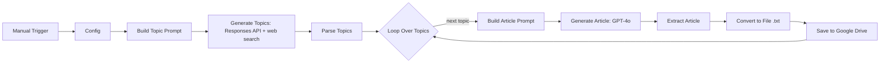

# Gaming Article Desk — n8n + OpenAI

n8n workflow that finds fresh article topics in the gaming niche with OpenAI web search, writes a human-sounding article for each topic with one natural anchor link, and saves it to Google Drive as a `.txt` file.

[Описание на русском](#на-русском)

## How it works

1. **Config** sets the number of topics, the article language, the anchor text and the target URL.
2. **Topic research.** GPT-4o with the `web_search_preview` tool (OpenAI Responses API) looks at recent industry news (patches, releases, events, tournaments) and returns a JSON array of concrete topics in the chosen language.
3. **Parsing.** The response is stripped of code fences and parsed. If the model returns no message or invalid JSON, the node stops with a clear error message.
4. **Article.** For each topic, a system prompt gives the model the voice of an experienced gaming journalist:
   - 2,500–3,500 characters;
   - varied sentence rhythm, first-person opinion, concrete details;
   - a list of banned clichés and canned transitions, with extra bans for French;
   - at most one bullet list;
   - one link with the given anchor, placed in context as the author's recommendation.
5. **Export.** The text is saved to Google Drive as `<topic> [<language>].txt`. The character count is kept in the item, so you can check the length.

## Stack

n8n · OpenAI API (Responses API with web search, Chat Completions, GPT-4o) · Google Drive API · JavaScript (Code nodes)

## Setup

1. Import `Ai-agent-for-blog-post-generator.json` into n8n.
2. Add your OpenAI key. The HTTP nodes **Generate Topics** and **Generate Article** expect the header `Authorization: Bearer YOUR_OPENAI_API_KEY`. It is safer to create a Header Auth credential and select it in both nodes.
3. Connect a Google Drive OAuth2 credential and set the folder ID in **Save to Google Drive**.
4. Edit **Config**: `topicsCount`, `language` (for example `english` or `français`), `anchorText`, `targetUrl`.
5. Run the workflow manually.

## Notes

- `max_tokens` for the article request is 1,200, which fits the 2,500–3,500 character target.
- The prompts inside the Code nodes are written in Russian. The article language is set separately in **Config**.

## На русском

n8n-воркфлоу для гейминг-ниши. GPT-4o с веб-поиском находит темы по свежим новостям: патчи, релизы, турниры. По каждой теме модель пишет статью на 2 500–3 500 знаков живым языком, без клише, с одной органичной ссылкой под заданный анкор. Готовая статья сохраняется в Google Drive как `.txt`.

Количество тем, язык, анкор и URL задаются в ноде **Config**. Ключ OpenAI указывается в заголовке `Authorization` двух HTTP-нод; надёжнее вынести его в Header Auth credential.
